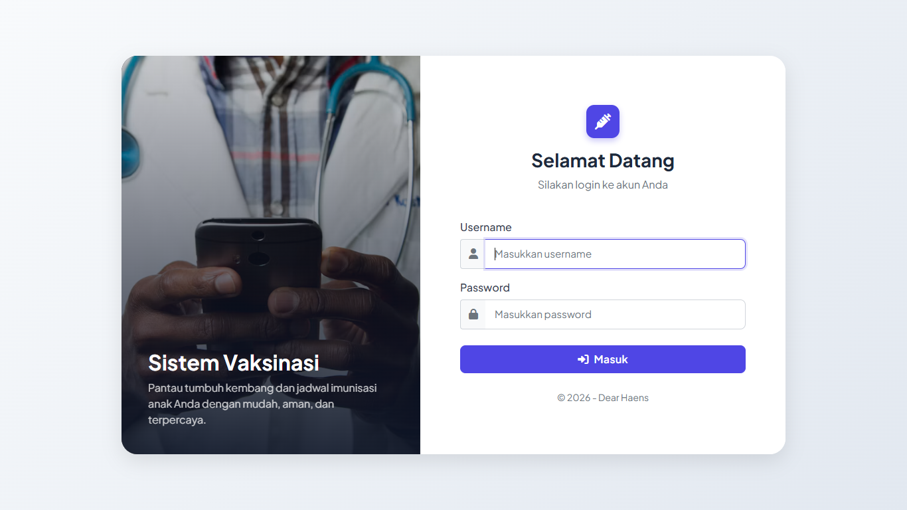
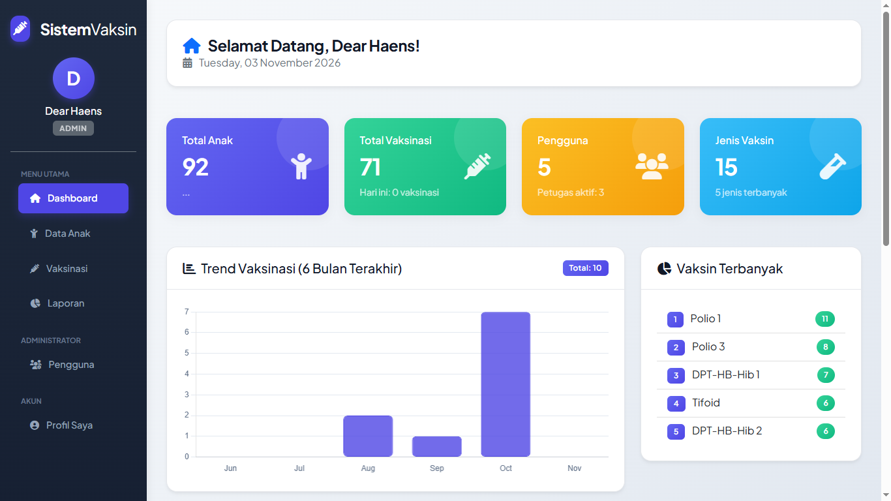
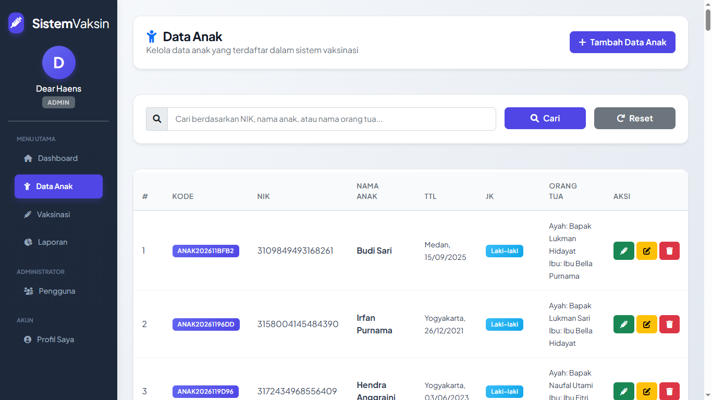
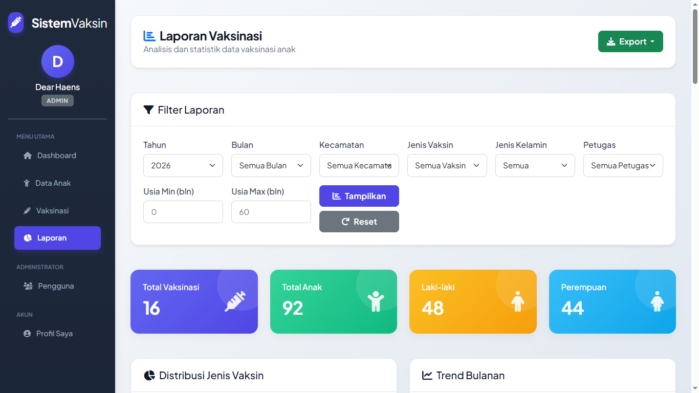

# 🩺 Sistem Informasi Vaksinasi Anak

Sistem Informasi Manajemen Vaksinasi Anak berbasis web yang dirancang untuk memodernisasi proses pencatatan dan pemantauan imunisasi anak. Aplikasi ini dibangun menggunakan **PHP Native** dengan arsitektur **Model-View-Controller (MVC)** dan database **MySQL**.

Proyek ini dikembangkan sebagai portofolio pengembangan perangkat lunak, dengan fokus pada keamanan aplikasi web, desain UI/UX modern, serta pengelolaan data vaksinasi secara terstruktur.

## ✨ Fitur Utama

- 🔐 **Autentikasi & Otorisasi Aman** — Sistem login menggunakan password hashing (Bcrypt), pencegahan Session Fixation, serta pembatasan hak akses berdasarkan peran (Admin dan Petugas).
- 📊 **Dashboard Interaktif** — Menampilkan statistik data anak, informasi vaksinasi terbaru, serta visualisasi data menggunakan Chart.js.
- 👶 **Manajemen Data Anak** — Fitur CRUD (Create, Read, Update, Delete) untuk mengelola data anak beserta informasi orang tua.
- 💉 **Manajemen Vaksinasi** — Pencatatan riwayat vaksinasi, penghitungan usia anak secara otomatis saat vaksinasi, serta pelacakan petugas yang menangani.
- 📑 **Laporan Dinamis** — Menyediakan filter data berdasarkan tahun, bulan, jenis vaksin, dan kecamatan. Dilengkapi fitur ekspor Excel dan cetak PDF.
- 🛡️ **Keamanan Aplikasi** — Perlindungan terhadap SQL Injection menggunakan Prepared Statements, pencegahan XSS melalui output escaping, serta CSRF Token pada setiap form.

## 🛠️ Teknologi yang Digunakan

| Kategori | Teknologi |
|---|---|
| Backend | PHP 8.x (Native PHP dengan arsitektur MVC) |
| Database | MySQL / MariaDB |
| Frontend | HTML5, CSS3, Bootstrap 5 |
| JavaScript | JavaScript, jQuery |
| Visualisasi Data | Chart.js |
| Notifikasi | SweetAlert2 |
| Tabel Data | DataTables |
| Date Picker | Flatpickr |
| Typography | Plus Jakarta Sans (Google Fonts) |

## 📸 Tampilan Aplikasi

Berikut beberapa tampilan antarmuka Sistem Informasi Vaksinasi Anak.

### 1. Halaman Login

Tampilan login dengan konsep split-screen modern dan ilustrasi bertema medis.



### 2. Dashboard Utama

Menampilkan statistik data, grafik tren vaksinasi, dan informasi data terbaru.



### 3. Manajemen Data Anak

Menampilkan tabel data anak yang dilengkapi fitur pencarian dan pengelolaan data melalui operasi CRUD.



### 4. Laporan Vaksinasi

Menampilkan laporan vaksinasi dengan filter dinamis, grafik distribusi, serta fitur ekspor laporan.



## 🚀 Cara Menjalankan Proyek Secara Lokal

Ikuti langkah-langkah berikut untuk menjalankan aplikasi di komputer menggunakan XAMPP.

### Prasyarat

Pastikan perangkat telah memiliki:

- PHP 8.x.
- MySQL atau MariaDB.
- XAMPP.
<<<<<<< HEAD
- Browser seperti Google Chrome atau Mozilla Firefox.

### Langkah Instalasi

**1. Clone Repository**

Buka terminal atau PowerShell, kemudian jalankan perintah berikut:

```bash
git clone https://github.com/yarhns/sistem-vaksinasi-anak.git
```

**2. Pindahkan Folder Project**

Pastikan folder proyek berada di direktori server lokal XAMPP:

```text
C:\xampp\htdocs\
```

Struktur direktori proyek menjadi:

```text
C:\xampp\htdocs\sistem-vaksinasi-anak\
```

**3. Konfigurasi Database**

Duplikasi file konfigurasi database:

```text
config/database.example.php
```

Kemudian ubah nama salinannya menjadi:

```text
config/database.local.php
```

Sesuaikan konfigurasi username dan password MySQL dengan pengaturan lokal Anda.

Pastikan file konfigurasi lokal tidak ikut diunggah ke repository publik karena dapat berisi informasi sensitif.

**4. Import Database**

Lakukan import database melalui phpMyAdmin:

1. Buka XAMPP Control Panel.
2. Jalankan Apache dan MySQL.
3. Buka browser dan akses `http://localhost/phpmyadmin`.
4. Buat database baru dengan nama `vaksinasi_anak`.
5. Pilih database tersebut.
6. Import file `database/schema.sql` terlebih dahulu.
7. Setelah berhasil, import file `database/seed.sql`.
8. Pastikan proses import selesai tanpa kesalahan.

**5. Jalankan Aplikasi**

Buka browser dan akses alamat berikut:

```text
http://localhost/sistem-vaksinasi
```

Aplikasi Sistem Informasi Vaksinasi Anak siap dijalankan.

## 🔑 Akun Default

Berikut kredensial akun administrator bawaan:

| Informasi | Detail |
|---|---|
| Username | `admin` |
| Password | `admin123` |
| Hak Akses | Admin |

> **Catatan Keamanan:** Akun di atas merupakan kredensial default yang disediakan untuk keperluan pengujian. Segera ganti password setelah login pertama, terutama jika aplikasi digunakan pada lingkungan publik atau produksi.

## 👨‍💻 Pengembang

**Dear Haens**

*Web Developer Enthusiast*

- GitHub: [@yarhns](https://github.com/yarhns)
- Repository: [Sistem Informasi Vaksinasi Anak](https://github.com/yarhns/sistem-vaksinasi-anak)

---
=======
>>>>>>> 9f474ac (docs: menambahkan screenshot dan memperbarui README)
